# DiskSweep

**Safe, transparent disk cleanup for Windows.** If your C: drive keeps filling up, DiskSweep
shows you where the space went and gets it back without touching your personal files.

- Cleans temp files, crash dumps, logs, thumbnail caches, the Recycle Bin, Windows Update
  leftovers and `Windows.old`
- Cleans browser caches (Chrome, Edge, Firefox, Brave) and developer caches (npm, Yarn, pnpm,
  pip, NuGet, Gradle, Maven, Cargo, Docker, WSL virtual disks)
- Runs advanced system cleanup: DISM component store, hibernation file, shadow-copy storage
- Includes a fast parallel **disk analyzer**, a **duplicate finder** and a **large/old file finder**
- Has a command-line tool and a GUI (dark and light themes), both built on the same core library
- Can schedule cleanups with Windows Task Scheduler
- **Dry run by default**, audit log of every deleted file, no telemetry

---

## Screenshots

These screenshots show the full cleanup flow, captured from the real GUI running against a
demo machine (sparse files that use no disk space). Regenerate them with
`python tools/capture_screenshots.py`.

**1. Start**: drive usage and the target checklist, before anything is measured.

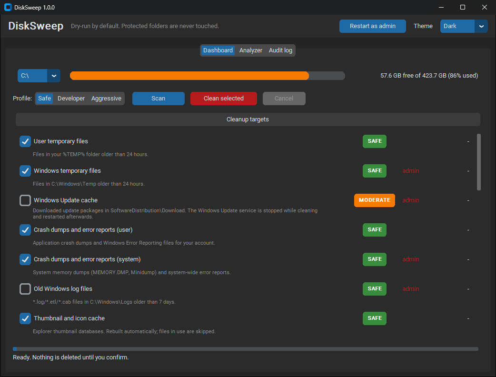

**2. Scanning**: runs in a background thread, so the window stays responsive.

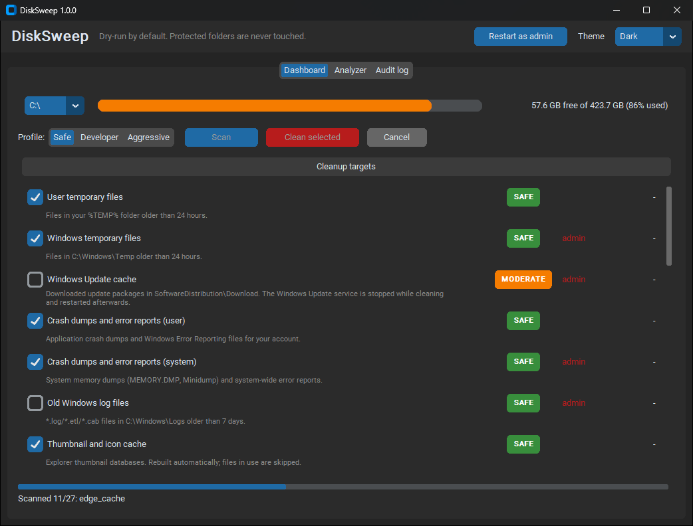

**3. Scan results**: sizes per target, risk badges, and admin-only targets marked. The *Safe*
profile is ticked.

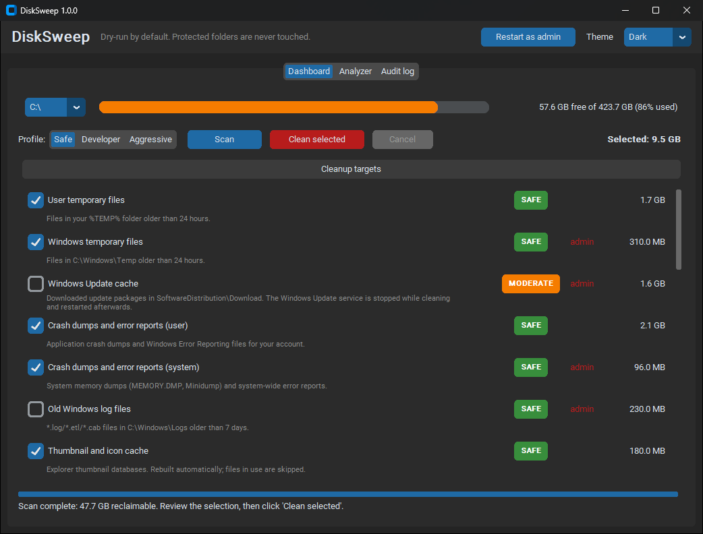

**4. Developer profile**: adds package-manager and build caches.

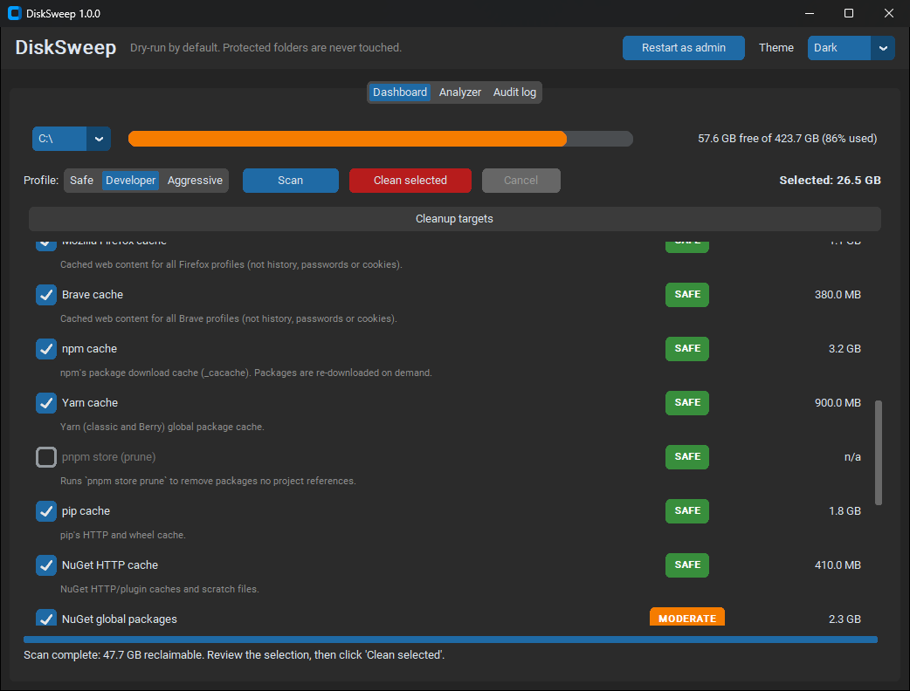

**5. Confirmation**: nothing is deleted until you confirm. Risky and admin-only targets
are called out.

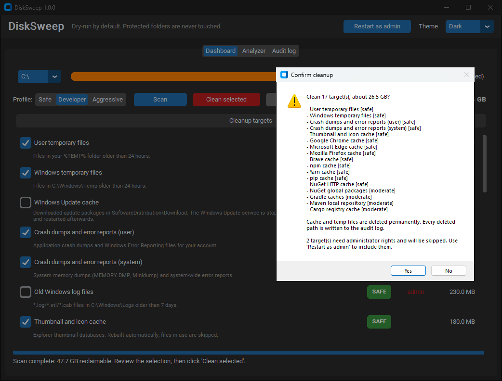

**6. Cleaning**: shows progress per target and can be cancelled.

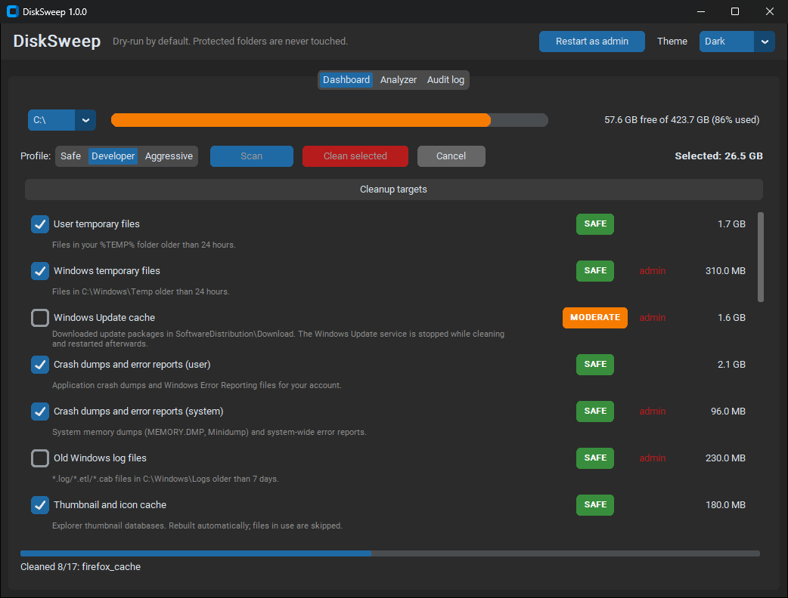

**7. Done**: space freed, free space before and after, and what was skipped and why
(here: no admin rights, and Chrome/Edge were open).

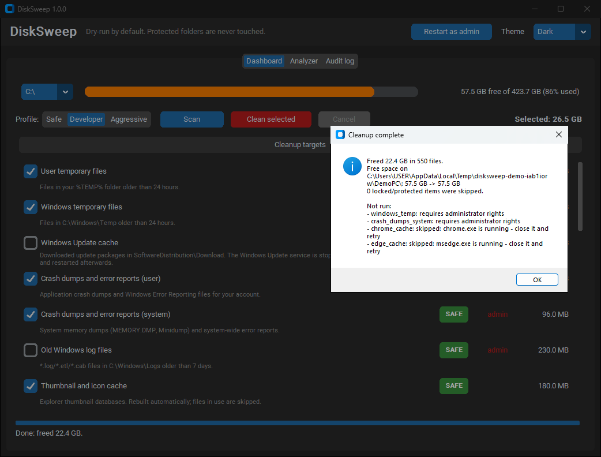

**8. Rescan**: what's left afterwards.

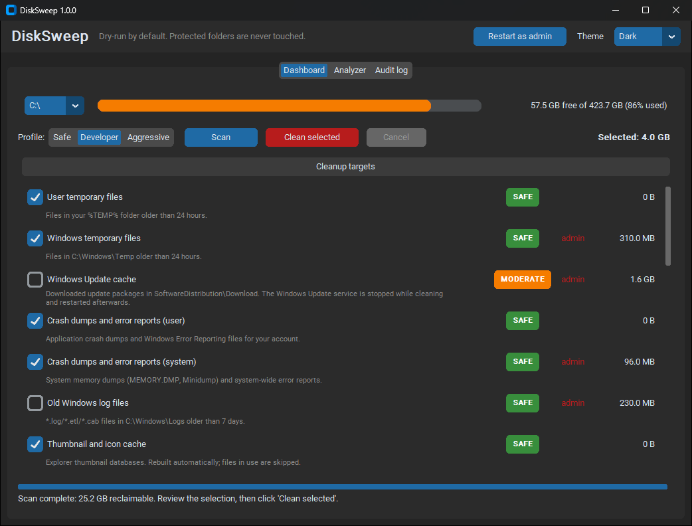

**9. Analyzer**: the largest folders and files, with JSON/CSV export.

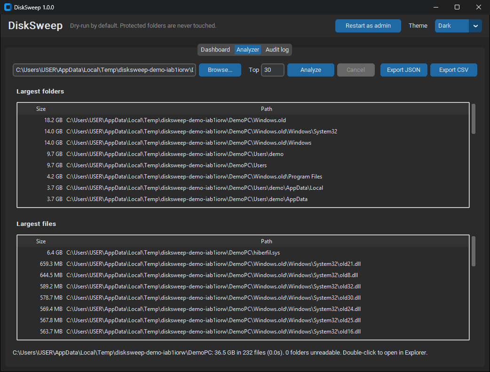

**10. Audit log**: every deleted path, with its size.

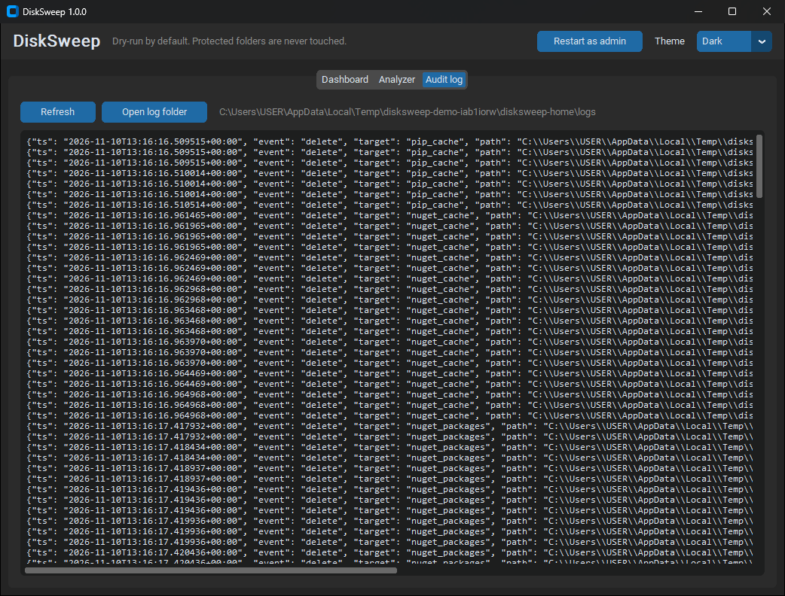

**Light theme**

| Dashboard | Analyzer |
|-----------|----------|
| 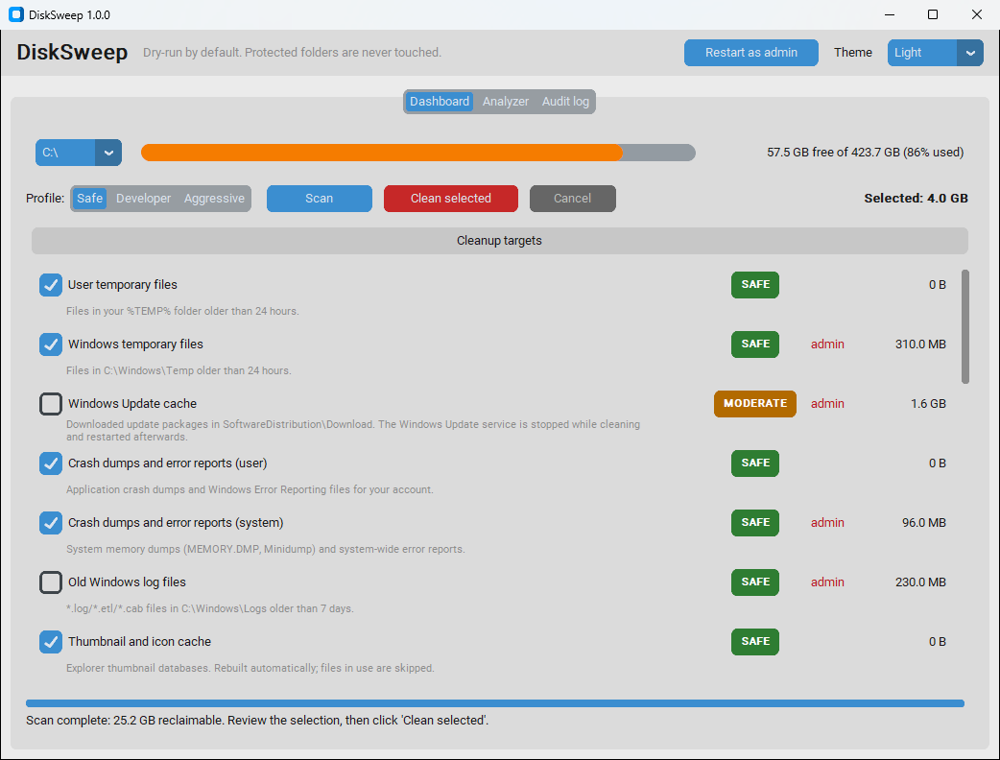 | 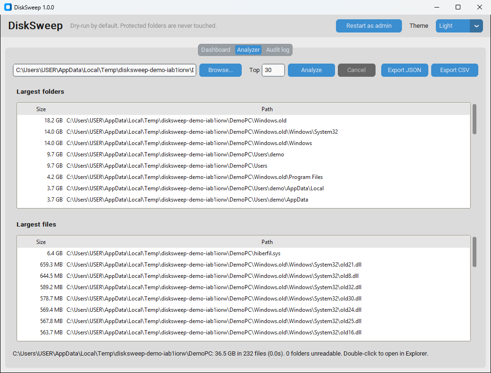 |

---

## Safety first

DiskSweep is built so that one bug or one typo can't wipe your files. These rules are
enforced in code and covered by tests:

| Guarantee | How |
|---|---|
| **Nothing is deleted unless you ask** | Every command is a dry run unless you pass `--apply`. In the GUI, cleaning needs a confirmation dialog. |
| **Protected folders can never be deleted** | A hard-coded guard blocks `C:\Windows` (except known cache folders like `Windows\Temp`), `System32`, `Program Files`, `ProgramData`, drive roots, `C:\Users`, your profile folder, `AppData` itself, **Documents, Desktop, Pictures, Videos, Music, OneDrive**, `.ssh`, and boot/page/hibernation files. Folders you've redirected (for example Documents moved to `D:\` or OneDrive) are detected through the Windows Known Folders API. Settings and command-line input can add to this list but can never shorten it. |
| **No symlink or junction escapes** | Folders are walked without following links. A link inside a cache folder is removed as a link, and its target is never entered. Every path is checked twice: as written, and after resolving links. It must stay inside its cleanup target's folder. |
| **One code path deletes** | Only `disksweep/fsops.py` removes files, and every removal goes through the guard. A test fails if any other module calls a delete function. |
| **Locked files are skipped** | Files that are in use or access-denied are reported as *skipped* instead of crashing the run. Temp files newer than 24 hours are left alone. |
| **Personal files go to the Recycle Bin** | The duplicate finder recycles files instead of deleting them. Only caches and temp data are deleted permanently. |
| **Admin only when needed** | DiskSweep runs as a normal user. Targets that need admin rights are skipped with a notice. You can re-launch elevated with `--elevate` or the GUI's *Restart as admin* button. |
| **Busy apps are left alone** | Browser caches are skipped while that browser is running. The Windows Update service is stopped during its cleanup and always restarted afterwards. |
| **Everything is logged** | Every deleted path, its size and the run's before/after free space go to a JSONL audit log in `%LOCALAPPDATA%\DiskSweep\logs\`. Run `disksweep log` to see it. |
| **No telemetry** | DiskSweep makes no network calls. The only exception is `disksweep update-check`, which runs only when you ask for it. |

### Risk levels

- **safe**: regenerable caches and temp data. The worst case is a slower first launch.
- **moderate**: data that has to be downloaded again (Gradle/Maven/NuGet packages, Docker
  images) or that you can see yourself (the Recycle Bin).
- **advanced**: system changes that can't be undone, such as removing `Windows.old` (no rollback),
  DISM cleanup, compacting WSL disks, shrinking restore points, or disabling hibernation.

---

## Install

### Option 1: download the executable

Download `DiskSweep.exe` (GUI) or `disksweep-cli.exe` (command line) from the
[Releases](https://github.com/muddasirfaiyaj66/DiskSweep/releases) page. Check them against
`SHA256SUMS.txt`. No installation is needed.

### Option 2: pip (Python 3.11+)

```powershell
pip install disksweep        # or, from a clone:  pip install .
disksweep --help
disksweep-gui
```

---

## Usage

### See what can be freed (read-only)

```powershell
disksweep scan                      # all targets
disksweep scan --profile developer  # one profile
disksweep targets                   # list targets, risk levels, profiles
```

### Clean

```powershell
disksweep clean --profile safe            # preview (dry run)
disksweep clean --profile safe --apply    # actually delete
disksweep clean --target chrome_cache --target npm_cache --apply
disksweep clean --profile aggressive --apply --elevate   # relaunch as admin
```

For `moderate` or `advanced` targets, `--apply` asks you to confirm. Pass `--yes` to skip
the prompt in scripts.

| Profile | Contains |
|---|---|
| `safe` | User/Windows temp, crash dumps, thumbnail cache, browser caches |
| `developer` | `safe` plus npm, Yarn, pnpm, pip, NuGet, Gradle, Maven, Cargo, Docker |
| `aggressive` | Everything except `hibernation_off`, which you have to select by itself |

### Find what is using space

```powershell
disksweep analyze C:\ --top 30
disksweep analyze C:\Users\me --max-depth 2 --json report.json --csv report.csv
disksweep large C:\Users\me --min-size 1GB --older-than 180
```

### Duplicates

```powershell
disksweep duplicates D:\Downloads --min-size 10MB
disksweep duplicates D:\Downloads D:\Photos --remove --keep oldest           # preview
disksweep duplicates D:\Downloads --remove --keep oldest --apply             # recycle copies
```

Files are matched in three steps: same size, then a BLAKE2b hash of the first and last 64 KiB,
then a full BLAKE2b hash. Hard links are recognised and aren't counted as duplicates.

### Scheduled cleanup

```powershell
disksweep schedule --weekly --profile safe            # Sundays 03:00
disksweep schedule --daily --time 02:30 --profile developer
disksweep schedule --show
disksweep schedule --remove
disksweep schedule --weekly --dry-run                 # print the schtasks command only
```

Scheduled runs use `--apply --yes --quiet` and write to the same audit log. Add `--highest`
to include admin-only targets (creating that task needs an elevated prompt).

### Audit log

```powershell
disksweep log --tail 100
disksweep log --path
```

---

## Build from source

```powershell
git clone https://github.com/muddasirfaiyaj66/DiskSweep
cd disksweep
python -m venv .venv
.venv\Scripts\activate
pip install -e ".[dev]"

ruff check . ; ruff format --check .
pytest

pyinstaller --clean --noconfirm disksweep.spec
# -> dist\DiskSweep.exe and dist\disksweep-cli.exe
```

The tests run on Linux and macOS too. Windows-only calls are mocked, and the Windows
path rules are tested with `ntpath`.

---

## Project layout

```
src/disksweep/
  safety.py       PathGuard: protected paths, link resolution, containment
  fsops.py        the only module that deletes (guarded, link-safe, locked-file tolerant)
  audit.py        JSONL audit log
  osutils.py      every Windows/OS call (single mocking seam)
  targets/        cleanup targets (system, browsers, dev, advanced) + registry
  engine.py       scan/clean orchestration, before/after free space
  profiles.py     safe / developer / aggressive
  analyzer.py     parallel folder-size scanner, JSON/CSV export
  duplicates.py   size -> partial hash -> full hash
  largefiles.py   large/old file finder
  scheduler.py    Task Scheduler integration
  updatecheck.py  opt-in update check (the only network code)
  cli.py          argparse CLI
  gui/            CustomTkinter GUI (worker threads, never blocks the UI)
```

## Contributing and security

See [CONTRIBUTING.md](CONTRIBUTING.md). To report anything that could make DiskSweep delete
the wrong thing, follow [SECURITY.md](SECURITY.md).

## License

MIT. See [LICENSE](LICENSE).
